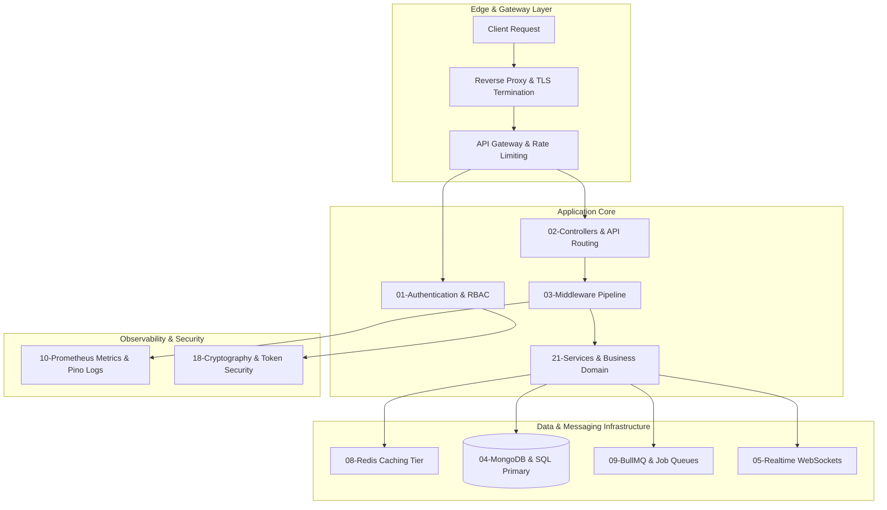

# Full Project Analysis: Backend Mastery

## 0.1 What the Project Is
**Backend Mastery** is an encyclopedic, production-grade backend engineering knowledge base and reference implementation spanning 30 core modules of modern server-side architecture.

Engineered to transition developers from basic CRUD APIs to senior-level systems design, it covers Node.js internals, event loops, thread pools, cryptographic primitives, distributed caching, ACID ledger transactions, real-time message meshes, and multi-tenant SaaS scaling.

## 0.2 System Architecture Diagram

## 0.3 Inventory Counts
- **Total Backend Modules**: 30 deep-dive subsystems (`01` through `30`).
- **Domain Controllers**: 120+ specialized controllers spanning authentication, payments, caching, and streaming.
- **Architectural Topics**: Event loop microtasks, Redis clustering, BullMQ backpressure, ACID transactions.
