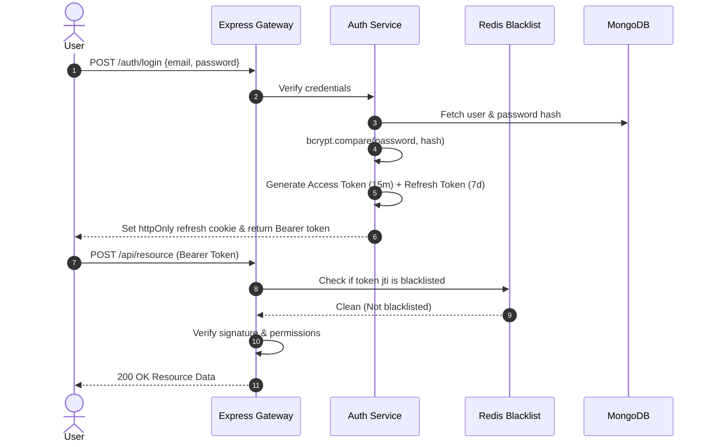
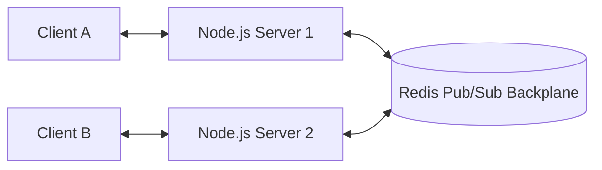

# Feature Inventory & Architectural Traces

## Core Subsystems Overview

| Feature ID | Feature Name | Primary Module References | Description |
|---|---|---|---|
| **F1** | Distributed Authentication & RBAC | `01-authentication/`, `07-security/` | Dual JWT access/refresh token rotation, role/permission authorization, token blacklists. |
| **F2** | Real-Time WebSockets & Event Mesh | `05-realtime-communication/` | Socket.IO room multiplexing, Redis pub/sub backplane, user presence tracking. |
| **F3** | Caching, Queues & Background Workers | `08-caching/`, `09-jobs-queues/` | Redis cache-aside caching, BullMQ asynchronous job queues with exponential backoff. |
| **F4** | Cryptography & FinTech Ledger Patterns | `18-cryptography/`, `19-payments-fintech/` | Double-entry accounting ledger, AES-256 data encryption, idempotency key locking. |
| **F5** | Multi-Tenant SaaS & Observability Mesh | `10-observability/`, `30-saas-multitenancy/` | Scoped tenant database routing, Pino structured logging, Prometheus metrics endpoints. |

---

## F1: Distributed Authentication & RBAC
Implements secure user onboarding, password hashing with bcrypt, stateless JWT issuance, refresh token rotation, and fine-grained permission enforcement.

### Say It Out Loud
> "In `01-authentication`, I implemented enterprise authentication. It utilizes a dual-token strategy: a short-lived 15-minute JWT access token sent in the Authorization header, and an httpOnly, SameSite refresh token cookie. To support instant revocation without sacrificing statelessness, logged-out tokens are stored in Redis with a TTL matching the token lifetime, ensuring compromised sessions are revoked immediately."

---

## F2: Real-Time WebSockets & Event Mesh
Bi-directional real-time communication layer supporting horizontal scaling across multiple Node.js instances via Redis pub/sub.

### Say It Out Loud
> "In `05-realtime-communication`, I built a horizontally scalable WebSocket mesh using Socket.IO and the Redis adapter. When a message is sent in a chat room, the local server publishes the event to Redis, which broadcasts it across all Node instances in the cluster so clients connected to any server receive the event instantly."

---

## F3: Caching, Queues & Background Workers
High-throughput caching and job processing layer mitigating database strain under heavy loads.

### Say It Out Loud
> "In `08-caching` and `09-jobs-queues`, I implemented a resilient caching and background processing architecture. Reads query Redis using the cache-aside pattern, while heavy asynchronous workloads—like invoice generation and email dispatch—are pushed to BullMQ queues with exponential backoff and dead-letter queues."

---

## F4: Cryptography & FinTech Ledger Patterns
Double-entry general ledger architecture guaranteeing zero money creation bugs.

### Say It Out Loud
> "In `19-payments-fintech`, I engineered a double-entry financial ledger. Every fund movement generates two atomic ledger entries—a debit and a credit. Balances are derived from immutable journal entries, preventing race-condition overdrafts and ensuring full financial auditability."

---

## F5: Multi-Tenant SaaS & Observability Mesh
Dynamic database connection management for multi-tenant SaaS paired with structured logging and Prometheus metrics.

### Say It Out Loud
> "In `30-saas-multitenancy` and `10-observability`, I built a multi-tenant SaaS architecture with dynamic connection pooling. Queries are strictly scoped to the authenticated tenant, while Pino and Prometheus record request durations, error rates, and active database connection metrics."
