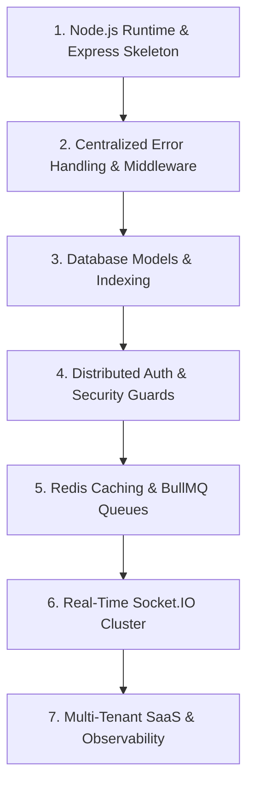

# Build Order: Constructing a Production Backend

## Step-by-Step Architecture Roadmap

1. **Runtime & Gateway**: Initialize Node.js 20+ with TypeScript and Express, configuring helmet, cors, and pino logging.
2. **Middleware Pipeline**: Establish centralized error handler, request correlation IDs, and input validation schemas.
3. **Data Layer**: Implement Mongoose schemas with compound indexes and ACID transaction helpers.
4. **Security & Auth**: Mount JWT token issuance, bcrypt hashing, and Redis token blacklisting.
5. **Caching & Workers**: Integrate Redis cache-aside helpers and BullMQ worker processors.
6. **Real-Time Mesh**: Configure Socket.IO with Redis adapter for distributed pub/sub.
7. **Multi-Tenancy & Metrics**: Deploy tenant scoping middleware and Prometheus metrics scrapers.
