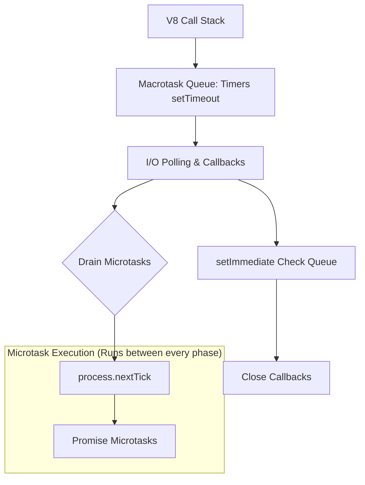

# Architecture & Node.js Internals

## The libuv Event Loop & Thread Pool

## Non-Blocking Asynchronous I/O
Node.js delegates file system and DNS operations to the libuv thread pool (default 4 threads), while network sockets are monitored using native kernel mechanisms (`epoll` on Linux, `kqueue` on macOS), allowing a single thread to handle tens of thousands of concurrent connections.
